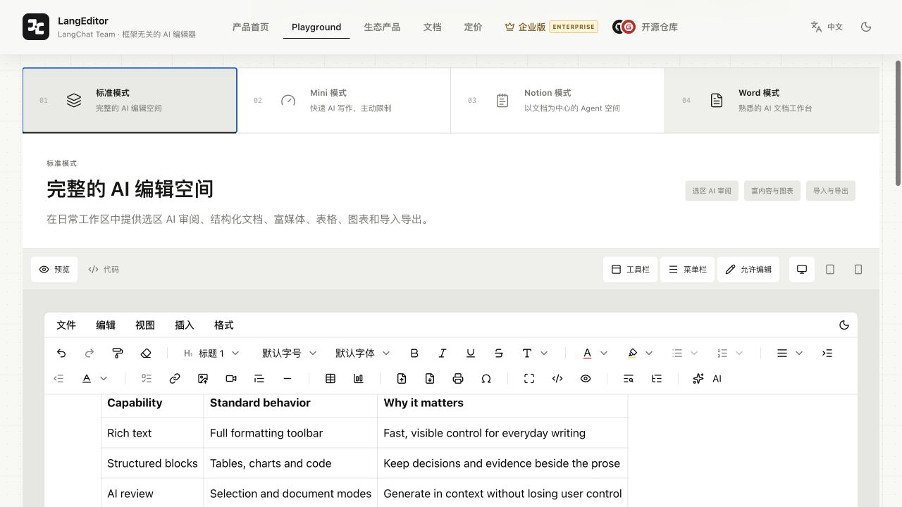
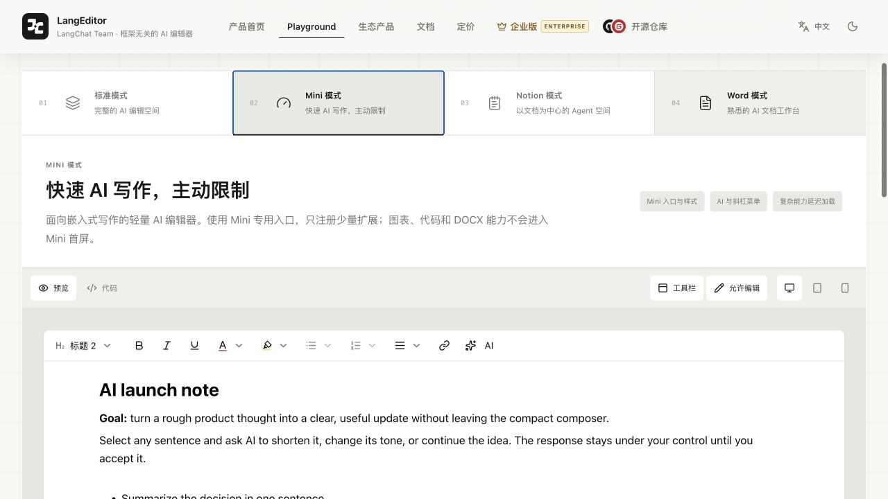
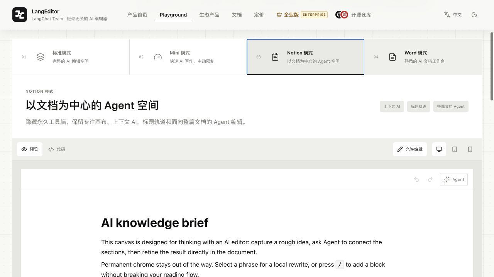
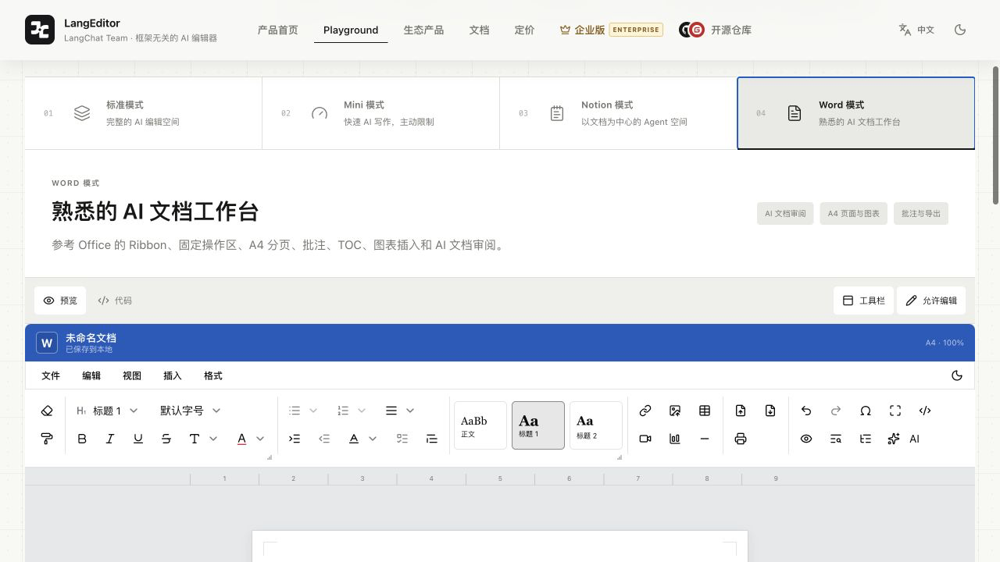

<p align="center">
  <a href="https://langeditor.cn">
    
  </a>
</p>

<h1 align="center">LangEditor</h1>

<p align="center">
  <a href="./README.md">中文</a>
</p>

<p align="center">
  A framework-agnostic, open-source AI editor for JavaScript products.<br />
  Embed the same AI editing runtime in vanilla JS, React, Vue 3, Svelte, Angular, JSP/Servlet, or any server-rendered page.
</p>

<p align="center">
  <a href="https://www.npmjs.com/package/@langeditor/core"></a>
  <a href="./LICENSE"></a>
  <a href="https://www.typescriptlang.org"></a>
</p>

<p align="center">
  <a href="https://langeditor.cn">Website</a>
  ·
  <a href="https://langeditor.cn/playground">Playground</a>
  ·
  <a href="https://langeditor.cn/docs">Documentation</a>
  ·
  <a href="https://github.com/tycoding/langeditor/issues">Issues</a>
</p>

Live preview: <https://langeditor.cn>

---

LangEditor is an AI-first editing system, not only a traditional rich-text toolbar. It keeps selection AI, whole-document Agents, streaming generation, reviewable suggestions, structured content, import/export, and pagination in one document context. The editor core is built with Tiptap; the cross-framework boundary is a self-contained Web Component with DOM properties and CustomEvents.

## Why LangEditor

- **AI-native editing:** rewrite, expand, summarize, translate, continue, and review content in context.
- **Four editor surfaces:** `default`, `mini`, `notion`, and `word` share one document foundation.
- **Composable extensions:** import only the capabilities your product needs and configure each extension independently. The dedicated `@langeditor/core/mini` entry keeps DOCX, charts, and code editing out of the Mini initial load.
- **Optional DOCX plugin:** install `@langeditor/plugin-docx` only when DOCX import/export is needed; its parser and serializer stay outside the core bundle.
- **Framework-neutral runtime:** use the Web Component in any JavaScript host; use the thin React adapter when typed React props and refs are preferred.
- **TypeScript-ready:** published entry points include declaration files for editor options, events, AI details, and adapter props.
- **Isolated instances:** multiple editors can coexist without leaking content, preview, print, TOC, or UI state.

## Install

```bash
pnpm add @langeditor/core
# or
npm install @langeditor/core
```

## Cross-framework quick start

The recommended integration boundary is the Web Component. The `element` entry includes the editor runtime, styles, AI extensions, and custom-element registration:

```js
import '@langeditor/core/element'
import { AI, BaseKit, History } from '@langeditor/core/element'

const editor = document.querySelector('lang-editor')
editor.value = '<h1>AI launch brief</h1><p>Select text to ask AI.</p>'
editor.extensions = [BaseKit, History, AI]
editor.addEventListener('lc-change', event => {
  console.log(event.detail.value, event.detail.format)
})
editor.openAI('document')
```

```html
<lang-editor mode="default" min-height="360"></lang-editor>
```

The same element works in vanilla JS, Vue, Svelte, Angular, Preact, Solid, JSP/Servlet, and other pages that can load JavaScript. React applications can install the thin adapter:

```bash
pnpm add @langeditor/core @langeditor/react
```

```tsx
import { LangEditor } from '@langeditor/react'

export function Writer() {
  return <LangEditor mode="default" onAiRequest={event => console.log(event.detail)} />
}
```

All hosts share the same protocol: DOM properties for complex configuration and CustomEvents such as `lc-ready`, `lc-input`, `lc-change`, `lc-enter`, `lc-error`, and `lc-ai`. AI lifecycle details include `start`, `delta`, `complete`, `error`, `abort`, `accept`, `reject`, `insert`, and `regenerate`.

## Editor modes

| Mode | Best for | Typical capabilities |
| --- | --- | --- |
| `default` | Structured writing and content back office | Full toolbar, menubar, rich blocks, selection AI |
| `mini` | Comments, summaries, messages, embedded writing | `@langeditor/core/mini`, compact controls, and an explicit extension allowlist |
| `notion` | Knowledge bases and long-form thinking | Heading rail, contextual AI, whole-document Agent |
| `word` | Reports and business documents | Ribbon, A4 pages, TOC, comments, review, export |

### Standard



### Mini



### Notion



### Word



```ts
import MiniLangEditor, {
  BaseKit, History, Heading, Bold, Italic, AI, MINI_EXTENSIONS,
} from '@langeditor/core/mini'
import '@langeditor/core/mini.css'

const extensions = [BaseKit, History, Heading, Bold, Italic, AI]

const config = {
  mode: 'mini',
  hideToolbar: false,
  hideMenubar: true,
  miniExtensions: [...MINI_EXTENSIONS],
}

editor.extensions = extensions
Object.assign(editor, config)
```

## Plugins and AI

Import plugins explicitly from the package entry and add them to the current instance:

```ts
import {
  BaseKit, History, Heading, Bold, Italic, Underline,
  Color, Highlight, Link, Table, Chart, AI, SlashCommand,
} from '@langeditor/core/element'

editor.extensions = [BaseKit, History, Heading, Bold, Italic, Color, Highlight, Table, Chart, AI]
```

Configure an OpenAI-compatible server endpoint. Keep long-lived API keys on your server:

```ts
import { AI, createOpenAICompletions } from '@langeditor/core'

const ai = AI.configure({
  completions: createOpenAICompletions({ baseURL: '/api/ai/chat/completions' }),
  systemPrompt: 'You are a concise writing assistant.',
})

editor.extensions = [BaseKit, History, ai]
editor.openAI('selection')
editor.openAI('document')
```

## Development

```bash
git clone https://github.com/tycoding/langeditor.git
cd langeditor
pnpm install
pnpm check
```

Useful commands:

| Command | Purpose |
| --- | --- |
| `pnpm dev` | Watch and rebuild the public Vue package |
| `pnpm build:lib` | Build the Vue package |
| `pnpm build:element` | Build the self-contained Web Component |
| `pnpm type:check` | Check TypeScript |
| `pnpm lint` | Check code style |
| `pnpm check` | Run the full delivery checks |

See the [online documentation center](https://langeditor.cn/docs) for architecture, plugin configuration, AI/Agent events, framework adapters, and complete examples. Local examples are available in [`examples/`](./examples/README.md).

The [developer documentation](./docs/README.md) covers theming, style isolation,
Composer, document surfaces, and contribution guidelines.

### Tippy style isolation

Core marks every editor-owned popper with the `data-langeditor-editor` namespace and applies instance-level defaults, so host-level Tippy defaults do not change editor surfaces. Host applications should scope their own rules to a `data-*` marker instead of overriding bare `.tippy-box` or `.tippy-arrow` selectors. See [`docs/tippy-style-isolation.md`](./docs/tippy-style-isolation.md) for the integration pattern.

### Editor surface styling

The `radius` prop controls the root radius and Word page radius. Word mode omits
the outer editor border so the A4 page surface remains the only document boundary.
For regular and plugin document surfaces, customize the instance border through
`editorClass` or a wrapper selector:

```css
.my-editor {
  --lc-editor-border-color: hsl(220 10% 75% / 0.55);
  --lc-editor-border-width: 1px;
}
```

Word mode can fill the remaining height when its parent chain provides an explicit
height (or `height: 100%`) and `min-height: 0`. An `auto`-height parent has no
remaining height for CSS to resolve.

See [`docs/theming.md`](./docs/theming.md) for the complete public
class and theme-token contract.

## License

LangEditor is released under the [MIT License](./LICENSE).
