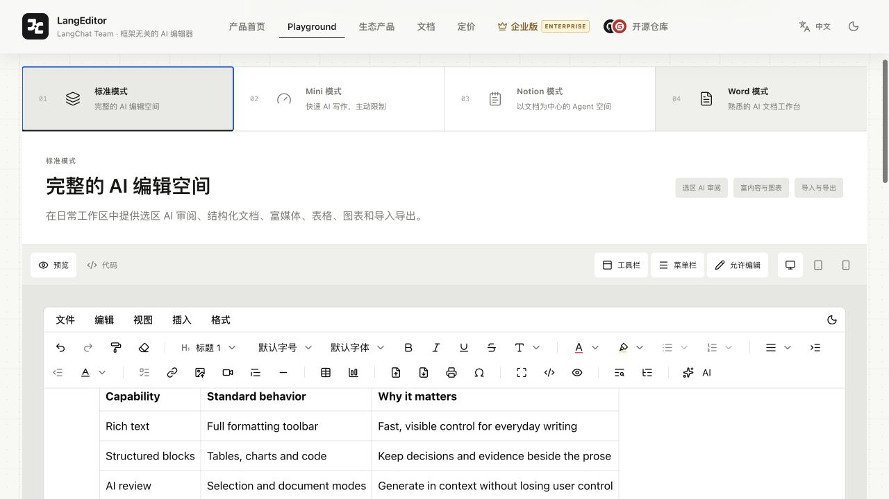
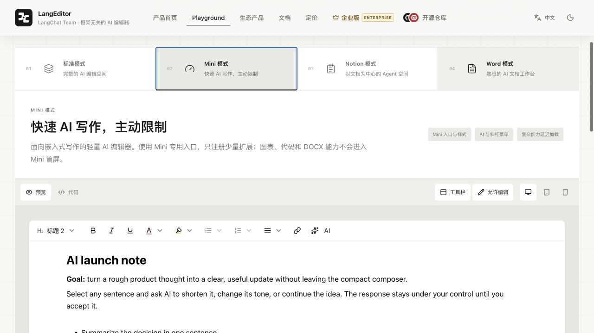
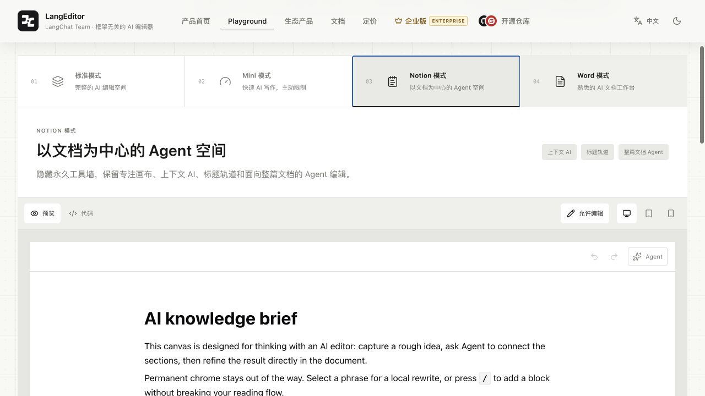
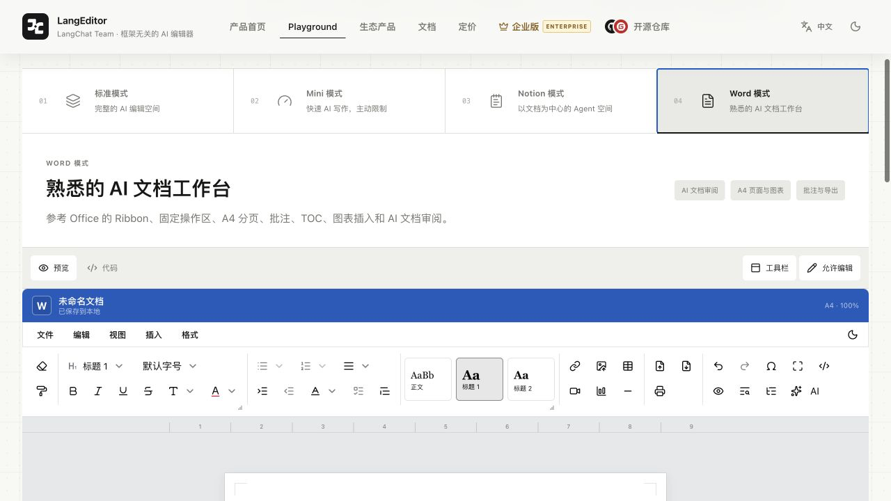

<p align="center">
  <a href="https://langeditor.cn">
    
  </a>
</p>

<h1 align="center">LangEditor</h1>

<p align="center">
  <a href="./README.en.md">English</a>
</p>

<p align="center">
  面向所有 JavaScript 应用的框架无关开源 AI 编辑器。<br />
  通过 Web Component 直接接入原生 JS、React、Svelte、Angular、JSP/Servlet 等环境，也提供 Vue 3 原生组件入口。
</p>

<p align="center">
  <a href="https://www.npmjs.com/package/@langeditor/core"></a>
  <a href="./LICENSE"></a>
  <a href="https://developer.mozilla.org/en-US/docs/Web/API/Web_components"></a>
  <a href="https://www.typescriptlang.org"></a>
</p>

<p align="center">
  <a href="https://langeditor.cn">产品官网</a>
  ·
  <a href="https://langeditor.cn/playground">Playground</a>
  ·
  <a href="https://langchat.cn">LangChat 官网</a>
  ·
  <a href="https://github.com/tycoding/langeditor/issues">问题反馈</a>
</p>

线上预览：<https://langeditor.cn>

---

LangEditor 是一套 AI-first、框架无关的可组合编辑系统，不只是传统富文本工具栏。它把选区级 AI、整篇文档 Agent、流式生成和可审阅的建议状态放回写作上下文，同时保留完整的文档结构、导入导出与分页能力。编辑器核心通过 Tiptap 构建，跨框架入口通过标准 Web Component 和 CustomEvent 协议提供；宿主应用可以是原生 JS、Vue、React、Svelte、Angular、Preact、Solid、JSP/Servlet，或任何能够输出 HTML 并加载 JavaScript 的 Java、PHP、.NET、Python 等服务端应用。

## 为什么选择 LangEditor

| 能力                  | 说明                                                                                                                |
| --------------------- | ------------------------------------------------------------------------------------------------------------------- |
| 四种产品形态          | `default`、`mini`、`notion`、`word` 使用同一套内容基础，分别服务标准 AI 编辑、快速输入、文档 Agent 和长文档工作流。 |
| AI 编辑扩展           | 选区改写、总结、续写、文档 Agent、流式生成与建议审阅按需组合。                                                      |
| 能力级 Mini 模式      | 不只是隐藏按钮；Mini 会过滤扩展集合，主动限制不必要的复杂操作。                                                     |
| Office 风格 Word 模式 | 固定 Ribbon、A4 分页、目录导航、状态栏与缩放控制共同构成长文档工作台。                                              |
| 主题与国际化          | 内置亮色、暗色、主题色、圆角配置、简体中文和英文界面。                                                              |
| AI 协议适配           | 使用原生 TypeScript `fetch` 与 SSE 解析器接入 OpenAI 兼容协议，不依赖 OpenAI SDK。                                  |
| 跨框架交付            | Web Component 自包含 Vue runtime、样式和编辑器能力；React 提供薄适配包，其他框架直接使用标准 DOM API。              |
| 实例隔离              | 多个编辑器可在同一应用中独立工作，预览、打印、目录与内容状态不会互相串扰。                                          |

## 四种 AI 编辑形态

### 标准模式

适合内容后台、知识库、文章编辑和常规业务表单。它保留完整菜单、工具栏、浮动菜单以及丰富的文档扩展，并支持选区 AI 改写、总结和上下文审阅。



### Mini 模式

适合评论、摘要、消息输入和嵌入式写作。它保留关键格式、文字颜色、背景色与斜杠菜单，让 AI 帮助把粗略想法快速整理成可发送内容，同时从扩展层限制复杂能力。

对首屏体积敏感的应用可以直接使用轻量入口：

```ts
import MiniLangEditor from '@langeditor/core/mini'
import '@langeditor/core/mini.css'
```

这个入口只包含编辑器壳、基础菜单和异步能力调度，不会把 DOCX 解析/导出、`uplot` 图表渲染器或 Prism 代码编辑器放进初始 JS。只有显式使用对应扩展并实际渲染节点时，浏览器才会请求它们的独立 chunk。需要完整扩展集合时再从 `@langeditor/core` 主入口导入。



### Notion 模式

适合知识库、研究笔记和长篇思考。它把编辑画布放在中心，通过上下文 AI 与整篇文档 Agent 完成总结、提纲、补写和结构化整理。



### Word 模式

适合报告、方案和长篇业务文档。界面提供 Office 风格 Ribbon、A4 页面、可折叠 TOC、页码与字数状态、阅读视图和缩放控制。



> 图片来自 LangEditor 的真实产品演示，并作为公开文档资产单独维护。

## 环境要求

- Node.js 20.19 或更高版本
- 现代浏览器：Chrome 88+、Edge 88+、Firefox 78+、Safari 14+
- pnpm 11（参与项目开发时使用）

Vue 3 只在直接使用 `@langeditor/core` 主入口时需要；使用 `@langeditor/core/element` 或 `@langeditor/react` 时，编辑器运行时会随产物提供，宿主应用不需要改造成 Vue 项目。

## 安装

```bash
pnpm add @langeditor/core
```

也可以使用 npm：

```bash
npm install @langeditor/core
```

Mini 入口与主包共用同一个 NPM 包，不需要额外安装或维护第二套编辑器：

```ts
import MiniLangEditor from '@langeditor/core/mini'
```

这里的“轻量”指浏览器构建和首屏加载路径。DOCX 导入导出通过独立的
`@langeditor/plugin-docx` 包按需安装；图表、代码等扩展仍由主包按需组合。
如果业务只使用 Mini，应用打包器不会把这些可选能力放入 Mini 首屏。

## 跨框架使用（推荐入口）

跨框架集成的推荐边界是 Web Component。`@langeditor/core/element` 会把 Vue runtime、编辑器样式、AI 能力和扩展运行时一起打进产物，宿主只需要使用标准自定义元素、DOM property 和 CustomEvent：

```js
import '@langeditor/core/element'
import { AI, BaseKit, History } from '@langeditor/core/element'

const editor = document.querySelector('lang-editor')
editor.value = '<h1>AI launch brief</h1><p>Select text to ask AI.</p>'
editor.extensions = [BaseKit, History, AI]
editor.addEventListener('lc-change', event => {
  console.log(event.detail.value, event.detail.format)
})

editor.openAI('document')
```

原生 JS、JSP/Servlet、Vue、Svelte、Angular、Preact、Solid 和其他支持 Web Components 的页面都可以直接使用 `<lang-editor>`；Java、PHP、.NET、Python 等服务端语言只需要把生成的 JS/CSS 作为静态资源输出即可。这些宿主共享同一套 DOM property 与 CustomEvent 协议，不需要重复实现编辑器。React 项目可以安装薄包装 `@langeditor/react`，它只负责 props、ref 和 DOM CustomEvents 的映射，不会复制编辑器 UI 或 AI 实现。主包的 Web Component 入口和 React 适配包都带有明确的 TypeScript declaration files，能够直接获得元素、props、事件和 AI detail 类型。

| 宿主环境                          | 推荐入口                   | 适配方式                                         |
| --------------------------------- | -------------------------- | ------------------------------------------------ |
| 原生 JS / JSP / Servlet           | `@langeditor/core/element` | `<lang-editor>` + DOM property + CustomEvent |
| Vue 3                             | `@langeditor/core`         | 原生 Vue 组件和 `v-model`                        |
| React                             | `@langeditor/react`   | 薄 wrapper + typed props/ref/events              |
| Svelte / Angular / Preact / Solid | `@langeditor/core/element` | 直接消费 Web Component                           |

跨框架适配层使用统一的 DOM 协议：`lc-ready`、`lc-session-ready`、`lc-input`、`lc-change`、`lc-enter`、`lc-error` 和 `lc-ai`。`lc-ai` 的 `detail.type` 覆盖 `start`、`delta`、`complete`、`error`、`abort`、`accept`、`reject`、`insert` 与 `regenerate`，因此原生 JS、React、JSP/Servlet 和其他框架都能观察同一条 AI 流式与审阅链路。复杂配置通过 DOM property 传递，AI 请求仍然使用 OpenAI-compatible Chat Completions + SSE；生产环境建议由 Servlet 或其他服务端代理保存模型密钥。

完整示例见 [`examples/`](./examples)。

### Tippy 样式隔离

编辑器弹层已经在 core 内使用 `data-langeditor-editor` 命名空间隔离宿主项目的 Tippy 默认样式。若宿主项目也使用 Tippy，请将自己的样式限定到自有 `data-*` 标识，避免使用裸 `.tippy-box`、`.tippy-arrow` 全局覆盖。完整说明和兼容现有 `initTippy()` 的写法见 [`docs/tippy-style-isolation.md`](./docs/tippy-style-isolation.md)。

## 可组合能力

LangEditor 的标准能力通过扩展按需组合：文本格式、列表、表格、图片、代码块、图表、目录、查找替换、预览打印与 AI 都可以独立配置；Word 导入导出由 `@langeditor/plugin-docx` 提供。未启用的能力不会占据工具栏，较重的文档运行时会在实际使用时异步加载。

扩展可以把操作放入现有菜单、工具栏、选区浮层、左右侧栏或状态栏；所有模式仍复用同一个编辑器实例、文档模型和事件协议。宿主只需显式导入需要的扩展或插件，不需要维护第二套编辑器实现。

```ts
import { BaseKit, Bold, Heading, History, Table } from '@langeditor/core'

const extensions = [BaseKit, History, Heading, Bold, Table]
```

公开插件示例见 [`examples/plugins/`](./examples/plugins/)，扩展 API、UI 插槽和文档模式协议见 [在线文档](https://langeditor.cn/docs)。

注意：上面的 `@langeditor/core/element` 是 npm 裸模块名，必须由 Vite/Webpack 等 bundler 或 import map 解析，不能直接在 `file://` 页面中解析。仓库里的 [`examples/vanilla/index.html`](./examples/vanilla/index.html) 使用 `lib/langeditor-element.umd.js`，执行 `pnpm build:element` 后可以直接双击打开。

## 快速开始（Vue 3 原生组件）

```vue
<script setup lang="ts">
import { ref } from 'vue'
import {
  BaseKit,
  AI,
  Bold,
  BulletList,
  Heading,
  History,
  Italic,
  LangEditor,
  Link,
  OrderedList,
  Underline,
} from '@langeditor/core'
import '@langeditor/core/style.css'

const content = ref('<h1>AI launch brief</h1><p>Select a sentence and ask AI to rewrite it in context.</p>')
const extensions = [BaseKit, History, Heading, Bold, Italic, Underline, Link, BulletList, OrderedList, AI]
</script>

<template>
  <LangEditor v-model="content" :extensions="extensions" :min-height="320" />
</template>
```

也可以全局安装组件：

```ts
import { createApp } from 'vue'
import LangEditor from '@langeditor/core'
import '@langeditor/core/style.css'
import App from './App.vue'

createApp(App).use(LangEditor).mount('#app')
```

## 切换编辑模式

模式是组件配置，不会改变 `v-model` 的使用方式。

```vue
<template>
  <!-- 完整编辑器 -->
  <LangEditor v-model="standardContent" :extensions="standardExtensions" mode="default" />

  <!-- 只开放必要能力的紧凑编辑器 -->
  <LangEditor
    v-model="miniContent"
    :extensions="miniExtensions"
    :mini-extensions="[
      'base-kit',
      'history',
      'heading',
      'bold',
      'italic',
      'underline',
      'color',
      'highlight',
      'bulletList',
      'orderedList',
      'textAlign',
      'link',
      'slashCommand',
      'AI',
    ]"
    mode="mini"
  />

  <!-- Office 风格分页工作台 -->
  <LangEditor
    v-model="documentContent"
    v-model:word-header-footer="wordHeaderFooter"
    :extensions="wordExtensions"
    :toc="{ enable: true, position: 'left', maxLevel: 3, defaultOpen: false }"
    :word-page-count="2"
    mode="word"
  />
</template>
```

## AI Composer 布局

`layout="composer"` 是标准编辑器实例上的输入布局能力，不会创建第二个
Tiptap 实例，也不会改变 `mode` 的扩展策略。省略 `layout` 时仍使用现有
`editor` 布局；`word` 模式暂不支持 Composer，并会回退到编辑器布局。

```vue
<script setup lang="ts">
import { ref } from 'vue'
import { BaseKit, Bold, History, Italic, LangEditor, Link } from '@langeditor/core'

const value = ref('')
const context = ref([])
const extensions = [BaseKit, History, Bold, Italic, Link]
const composer = {
  minHeight: 96,
  maxHeight: 320,
  actions: [{ id: 'scope', label: 'Project context', position: 'start' }],
  voice: {
    async transcribe(audio, { signal }) {
      return myTranscriptionService(audio, signal)
    },
  },
}
const mention = {
  sources: [{ id: 'people', items: query => searchPeople(query) }],
}
</script>

<template>
  <LangEditor
    v-model="value"
    v-model:composer-context="context"
    :composer="composer"
    :extensions="extensions"
    :mention="mention"
    layout="composer"
    @submit="payload => sendPrompt(payload)"
  />
</template>
```

Composer 内置上方 context tray、自动增长且受 `maxHeight` 限制的富文本输入、
“+”菜单、语音听写与发送/停止按钮。文件粘贴与拖拽会进入统一 context 模型；
没有文件的 HTML 粘贴继续交给 Tiptap，因此粗体、斜体、链接和列表等已启用格式
会被保留。可用 `composer-context`、`composer-footer-start`、
`composer-footer-center`、`composer-footer-end`、`composer-add-menu`、
`composer-voice` 和 `composer-send` 插槽替换内置区域。

提交事件返回 `{ html, json, text, contextItems, mentions, metadata }` 快照。
Vue 事件还包括 `stop`、`composer-action`、`context-add`、`context-remove`、
`mention-select`、`voice-state-change`、`voice-recorded`、
`transcription-complete` 和 `error`。语音核心只录制浏览器 `Blob`；转录必须由
宿主 `transcribe(audio, { signal, language })` Provider 完成，核心不会保存密钥
或绑定服务商。

Mention JSON 节点保存 `id`、`label`、`value`、`sourceId`、`trigger` 和
`metadata`。HTML 使用 `span[data-type="mention"]`，并明确序列化为
`data-mention-id`、`data-mention-label`、`data-mention-value`、
`data-mention-source`、`data-mention-trigger` 与 URI 编码 JSON 的
`data-mention-metadata`。

Web Component 的 `composer`、`composerContext`、`mention` 必须作为 DOM
property 赋值；对应事件为 `lc-submit`、`lc-stop`、`lc-composer-action`、
`lc-composer-context-change`、`lc-mention-select`、`lc-voice-state-change`、
`lc-voice-recorded`、`lc-transcription-complete` 和 `lc-error`。React 包只把
这些 property、CustomEvent 和元素 ref 方法映射为 props/callback/ref，不维护
独立状态或 UI。完整可运行示例见
[`examples/composer`](./examples/composer/README.md)。

如果产品只需要 Mini，建议直接从轻量入口导入组件和扩展，避免主入口的完整扩展导出参与应用构建：

```ts
import MiniLangEditor, {
  AI, BaseKit, Bold, Heading, History, Italic, MINI_EXTENSIONS,
} from '@langeditor/core/mini'
import '@langeditor/core/mini.css'
```

## 常用配置

| 参数               | 类型                                        | 默认值       | 说明                                   |
| ------------------ | ------------------------------------------- | ------------ | -------------------------------------- |
| `mode`             | `LcEditorMode`                              | `'default'`  | 内置或插件提供的文档编辑形态           |
| `documentSource`   | `LcDocumentSource`                          | 未设置       | 外部模式的 File、URL、Blob 或二进制输入 |
| `layout`           | `'editor' \| 'composer'`                     | `'editor'`   | 编辑器 chrome 与输入交互布局           |
| `composer`         | `LcComposerConfig`                            | 内置默认值   | Composer 高度、菜单、语音、action 与发送配置 |
| `composerContext`  | `LcComposerContextItem[]`                     | `[]`         | Composer 顶部统一上下文模型            |
| `mention`          | `LcMentionConfig`                             | 未启用       | 静态或异步 Mention source              |
| `modelValue`       | `LcDocumentValue`                           | `''`         | 富文本内容或外部文档的可序列化快照     |
| `output`           | `'html' \| 'json' \| 'text'`                | `'html'`     | `v-model` 输出格式                     |
| `extensions`       | `AnyExtension[]`                            | `[]`         | 启用的 Tiptap / LangEditor 扩展        |
| `miniExtensions`   | `string[]`                                  | 内置必要集合 | Mini 模式允许使用的扩展名称            |
| `wordPageCount`    | `number`                                    | `2`          | Word 模式展示的 A4 页数                |
| `wordHeaderFooter` | `WordHeaderFooterConfig`                    | 关闭         | 每页重复显示的页眉、页脚与页码配置     |
| `disabled`         | `boolean`                                   | `false`      | 禁止编辑                               |
| `hideToolbar`      | `boolean`                                   | `false`      | 隐藏工具栏                             |
| `hideMenubar`      | `boolean`                                   | `true`       | 隐藏顶部菜单栏                         |
| `hideBubble`       | `boolean`                                   | `false`      | 隐藏文本浮动菜单                       |
| `dark`             | `boolean`                                   | 跟随系统     | 使用暗色主题                           |
| `theme`            | `Theme`                                     | `'zinc'`     | 编辑器主题色                           |
| `radius`           | `BorderRadius`                              | `0.5`        | 组件圆角尺度                           |
| `minHeight`        | `string \| number`                          | 未设置       | 最小高度，数字按像素处理               |
| `maxHeight`        | `string \| number`                          | 未设置       | 最大高度，超出后滚动                   |
| `maxWidth`         | `string \| number`                          | 未设置       | 内容区域最大宽度                       |
| `toc`              | `TocConfig`                                 | 关闭         | 目录位置、最大层级、标题与默认展开状态 |

完整类型定义见 [`src/type.ts`](./src/type.ts)。

完整的公共 class 和主题变量协议见 [`docs/theming.md`](./docs/theming.md)。

### 外框、圆角与高度

编辑器根容器的圆角由 `radius` 控制，`word` 模式下同一个值也会应用到每个
A4 页面。普通编辑模式默认使用一层轻量 border；Word 模式不再绘制这层外框，
避免和页面自身的边界、阴影叠加。宿主可以通过 `editorClass` 或包裹容器覆盖
以下实例级 CSS 变量：

```css
.my-editor {
  --lc-editor-border-color: hsl(220 10% 75% / 0.55);
  --lc-editor-border-width: 1px;
  --lc-editor-primary: 221 83% 53%;
  --lc-editor-primary-foreground: 0 0% 100%;
}
```

`word` 模式会沿着父级的 flex 高度链填充可用空间。请确保直接父级和更上层
容器使用 `height: 100%`（或明确高度）以及 `min-height: 0`；如果父级高度是
`auto`，CSS 无法推导出剩余高度，编辑器只能按页面内容高度渲染并在内容区域滚动。

### 事件与编辑器实例

- `update:modelValue`：内容变化时更新 `v-model`。
- `change`：返回编辑器实例与当前输出内容。
- `enter`：配置 `enter` 后，在按下 Enter 时触发。
- `session-ready`：外部文档表面完成初始化后返回 `LcDocumentSession`。

需要直接调用 Tiptap API 时，可以通过组件引用取得实例：

```vue
<script setup lang="ts">
import { ref } from 'vue'

const editorRef = ref()

function focusEditor() {
  editorRef.value?.editor.commands.focus()
}
</script>

<template>
  <LangEditor ref="editorRef" />
</template>
```

## 扩展系统

项目导出的主要扩展包括：

- 基础：`BaseKit`、`History`、`Clear`、`FormatPainter`、`Fullscreen`
- 文本：`Bold`、`Italic`、`Underline`、`Strike`、`MoreMark`、`Color`、`Highlight`
- 排版：`Heading`、`FontSize`、`FontFamily`、`TextAlign`、`LineHeight`、`Indent`
- 内容块：`Blockquote`、`HorizontalRule`、`Code`、`CodeBlock`、`Iframe`、`Columns`
- 列表：`BulletList`、`OrderedList`、`TaskList`
- 媒体：`Image`、`ImageUpload`、`Video`、`VideoUpload`
- 文档：`Table`、`Link`、`Toc`、`FindAndReplace`、`SourceCode`、`Preview`、`Printer`
- 交互：`SlashCommand`、`Mention`、`SpecialCharacter`、`AI`

每个扩展都可以通过 `configure` 独立调整：

```ts
const extensions = [
  BaseKit.configure({
    placeholder: { placeholder: '输入内容...' },
    characterCount: { limit: 50000 },
  }),
  Heading.configure({ levels: [1, 2, 3] }),
  Image.configure({ inline: false }),
  Table.configure({ resizable: true }),
]
```

完整的公开接入示例见 [`examples/`](./examples/README.md)。更多可交互的模式、插件和框架配置见 [在线文档](https://langeditor.cn/docs)。

## AI 接入

LangEditor 内置 OpenAI Chat Completions 兼容适配器，通过浏览器原生 `fetch` 请求接口，并正确解析流式 SSE 数据。项目不包含也不需要 `openai` npm 依赖。

```ts
import { AI, createOpenAICompletions } from '@langeditor/core'

const ai = AI.configure({
  completions: createOpenAICompletions({
    temperature: 0.7,
  }),
  modelConfig: {
    model: 'gpt-4.1-mini',
    baseURL: 'https://api.openai.com/v1',
    apiKey: 'your-api-key',
  },
  showModelConfig: true,
})
```

`baseURL` 可以指向任何兼容 `/chat/completions` 与流式响应格式的服务。生产环境不应把长期有效的 API Key 直接写入前端代码；建议由自己的服务端代理鉴权，并通过 `headers` 或短期令牌接入。

如果需要完全控制请求过程，也可以向 `AI.configure({ completions })` 传入自己的回调。

## 文档工作流

### TOC 目录

启用 `Toc` 扩展并传入 `toc` 配置后，工具栏会显示目录开关。目录默认折叠；用户点击后才会从编辑区域左侧或右侧展开，并根据滚动位置同步当前标题层级。

### Word 导入导出

DOCX 能力通过独立的 [`@langeditor/plugin-docx`](./packages/editor-plugin-docx/README.md) 包提供，避免把 DOCX 运行时放进核心编辑器。安装并导入插件后，文件菜单和工具栏会提供 Word 导入导出入口；解析器和序列化器只在实际执行命令时加载。

DOCX 中尚未映射到编辑器 schema 的文本框、修订、复杂域和特殊布局不会被静默伪装成普通 HTML，导入时会通过 `warnings` 记录并在控制台提示。当前导入入口只接受 `.docx`，不处理旧的二进制 `.doc`。

### 预览与打印

预览会把当前实例切换为只读呈现，不再创建互相覆盖的全局弹窗。打印内容同样来自触发操作的编辑器实例，并使用独立打印样式。

## 本地开发

```bash
git clone https://github.com/tycoding/langeditor.git
cd langeditor
pnpm install
pnpm check
```

公共 workspace 包含 React 和 Svelte 示例。启动示例：

```bash
pnpm --filter langeditor-react-example dev
pnpm --filter langeditor-svelte-example dev
```

常用命令：

| 命令                 | 作用                                |
| -------------------- | ----------------------------------- |
| `pnpm dev`           | 监听并增量构建公共 Vue 发布包       |
| `pnpm build:lib`     | 构建公共 Vue 与 Mini 发布包         |
| `pnpm build:element` | 构建自包含 Web Component            |
| `pnpm type:check`    | 检查公共 TypeScript                 |
| `pnpm lint`          | 检查公共源码规范                    |
| `pnpm check`         | 执行公共仓库完整交付检查            |

## 项目结构

```text
langeditor/
├── src/
│   ├── components/       # 编辑器外壳、菜单、目录与对话框
│   ├── extensions/       # 可组合的 Tiptap 扩展
│   ├── hooks/            # 主题、状态、焦点与 TOC hooks
│   ├── locales/          # 简体中文与英文文案
│   └── styles/           # 以 data-langeditor 为边界的编辑器样式
├── packages/              # React 适配包与公开插件
├── examples/              # 原生 JS、React、Svelte、JSP/Servlet 示例
├── vite.element.config.ts # 自包含 Web Component 构建入口
└── README.en.md          # English project overview
```

编辑器的模块边界、插件生命周期、AI 事件协议、主题方案和构建流程见 [在线文档中心](https://langeditor.cn/docs)。

## 文档索引

- [开发文档目录](./docs/README.md)：主题定制、样式隔离、AI Composer 与文档模式插件
- [仓库架构](./ARCHITECTURE.md)：核心、扩展、插件与框架适配的依赖方向
- [在线文档中心](https://langeditor.cn/docs)：基础能力、模式、插件、AI、Agent、框架接入与配置参考
- [示例目录](./examples/README.md)：原生 JS、React、Svelte、JSP/Servlet
- [贡献指南](./CONTRIBUTING.md)
- [安全说明](./SECURITY.md)

## 常见问题

<details>
<summary><strong>Mini 模式只是把按钮隐藏了吗？</strong></summary>

不是。Mini 模式会根据 `miniExtensions` 过滤实际启用的扩展，未开放的命令不会仅仅因为隐藏了按钮而继续保留。
</details>

<details>
<summary><strong>同一页面可以放多个编辑器吗？</strong></summary>

可以。编辑器内容、预览、打印、TOC 与 UI 状态按实例隔离。Playground 采用单实例切换，是为了让演示行为更清晰，而不是组件的使用限制。
</details>

<details>
<summary><strong>必须使用 OpenAI 服务吗？</strong></summary>

不需要。默认适配器遵循 OpenAI 兼容协议，也可以替换为自己的 `completions` 回调，连接私有模型、服务端代理或其他流式生成服务。
</details>

<details>
<summary><strong>必须使用 Vue 才能接入吗？</strong></summary>

不需要。Vue 3 只是主包提供的原生组件入口。其他 JavaScript 框架和 JSP/Servlet 页面使用 `@langeditor/core/element` Web Component；React 可以使用 `@langeditor/react` 薄适配包。所有入口共享同一套编辑器能力、AI 事件协议和 TypeScript 类型。
</details>

## 参与贡献

欢迎提交 Issue、文档改进、扩展能力与修复。开始前请阅读：

- [贡献指南](./CONTRIBUTING.md)：开发环境、分支、提交与 Pull Request 约定
- [安全说明](./SECURITY.md)：私下报告安全问题的方式

提交 Pull Request 前建议运行 `pnpm check`，并同步更新受影响的公开文档与示例。

## LangChat Team

LangEditor 由 **LangChat Team** 构建和维护，是 LangChat 开源 AI 产品生态中的编辑基础设施。

- LangChat 官网：[https://langchat.cn](https://langchat.cn)
- LangEditor 官网：[https://langeditor.cn](https://langeditor.cn)
- 开源仓库：[https://github.com/tycoding/langeditor](https://github.com/tycoding/langeditor)

## 致谢

项目建立在 [Vue](https://vuejs.org)、[Tiptap](https://tiptap.dev)、[Reka UI](https://reka-ui.com) 与 [Lucide](https://lucide.dev) 等优秀开源项目之上。

## 许可证

LangEditor 基于 [MIT License](./LICENSE) 开源。你可以自由使用、修改和分发，并保留许可证与版权声明。
